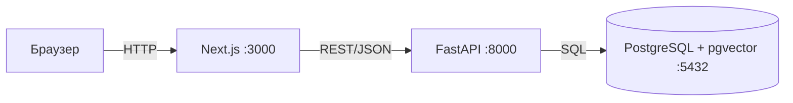
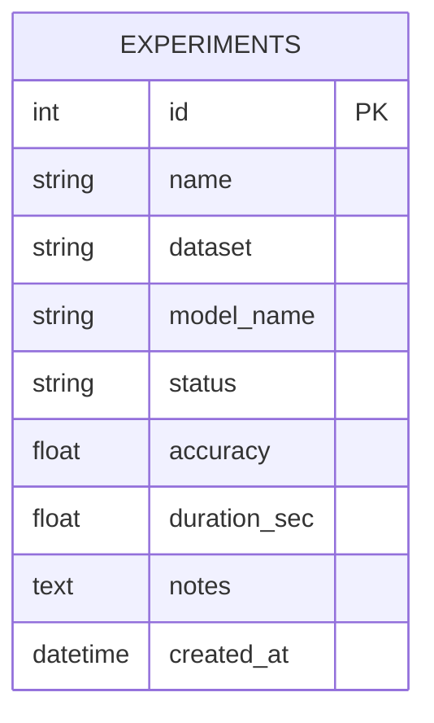

# Architecture

## Стек
Next.js 15 + TypeScript + Tailwind, FastAPI + Pydantic, SQLAlchemy 2 + Alembic, PostgreSQL, Docker Compose, GitHub Actions.

## ER

## API
| Метод | Путь | Описание | Коды |
|---|---|---|---|
| GET | /health | проверка | 200 |
| GET | /experiments | список, поиск q, фильтр status, пагинация, сортировка | 200, 422 |
| GET | /experiments/stats | агрегаты для дашборда | 200 |
| GET | /experiments/{id} | карточка | 200, 404 |
| POST | /experiments | создать | 201, 422 |
| PATCH | /experiments/{id} | обновить | 200, 404, 422 |
| DELETE | /experiments/{id} | удалить | 204, 404 |

## Решения
1. Модульный монолит (experiments) — проще микросервисов для масштаба.
2. FastAPI, а не Django — лёгкий REST + автодоки /docs.
3. Слои models/schemas/service/router — разделение БД/валидации/логики/HTTP.
4. Миграции Alembic — единственное изменение схемы.
5. SQLite в тестах — быстро без Postgres.
